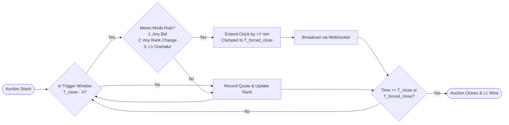

# 🏛️ British Reverse Auction Engine for Freight Logistics RFQ

[](https://github.com/nandeesh2799/RFQ_System/actions/workflows/ci.yml)
[](https://fastapi.tiangolo.com)
[](https://react.dev)
[](https://www.typescriptlang.org)
[](https://www.postgresql.org)
[](https://tailwindcss.com)
[](https://playwright.dev)
[](https://pytest.org)
[](LICENSE)

An enterprise-grade **British Reverse Auction Engine** engineered for commercial freight procurement and Request for Quotation (RFQ) platforms. Implements mathematically rigorous dynamic overtime extensions, anti-sniping protection, ACID row-level locking for concurrent bids, and low-latency WebSocket live updates.

---

## 📑 Table of Contents

- [Overview & Auction Mechanics](#-overview--auction-mechanics)
  - [Anti-Sniping Parameters](#anti-sniping-parameters)
  - [Extension Trigger Modes](#extension-trigger-modes)
- [System Architecture](#-system-architecture)
- [Repository Structure](#-repository-structure)
- [Tech Stack](#-tech-stack)
- [Quick Start & Installation](#-quick-start--installation)
  - [Prerequisites](#prerequisites)
  - [Step 1: Database Setup](#step-1-start-database-postgresql-16)
  - [Step 2: Backend Setup & Seeding](#step-2-setup-backend--seed-demo-data)
  - [Step 3: Frontend Setup](#step-3-start-frontend-dev-server)
- [REST API & WebSocket Reference](#-rest-api--websocket-reference)
- [Automated Testing Suite](#-automated-testing-suite)
- [Demo Personas & Test Accounts](#-demo-personas--test-accounts)
- [Architecture & Design Documentation](#-architecture--design-documentation)

---

## 🎯 Overview & Auction Mechanics

In commercial freight procurement, buyers publish RFQs with initial ceiling prices. Pre-qualified carrier suppliers submit descending bids comprising **Base Freight**, **Fuel Surcharge**, and **Handling Fees**. 

A **British Auction** balances competitive price discovery with deterministic scheduling:
1. Prevents last-second **bid sniping** by dynamically extending the auction clock if competitive bidding occurs inside the trigger window.
2. Guarantees a hard deadline via a mandatory **Forced Close Time** cap beyond which no extension can push the auction.



### Anti-Sniping Parameters

| Parameter | Mathematical Symbol | Description |
| :--- | :---: | :--- |
| **Trigger Window** | $X$ | Monitoring window right before close time: $[T_{\text{close}} - X, T_{\text{close}}]$. |
| **Extension Duration** | $Y$ | Minutes added to $T_{\text{close}}$ whenever the extension condition is satisfied. |
| **Current Close Time** | $T_{\text{close}}$ | Dynamic deadline recalculated on qualifying bids. |
| **Forced Close Deadline** | $T_{\text{forced\_close}}$ | Non-negotiable ceiling: $\text{New Close Time} = \min(T_{\text{close}} + Y, T_{\text{forced\_close}})$. |

### Extension Trigger Modes

| Trigger Mode | Enum Key | Extension Evaluation Rule |
| :--- | :--- | :--- |
| **Mode 1: Any Bid** | `BID_RECEIVED` | Any valid quote placed in the final $X$ minutes extends the clock by $+Y$ min. |
| **Mode 2: Any Rank Shift** | `ANY_RANK_CHANGE` | Extends by $+Y$ min only if the bid improves **any carrier's rank** (e.g., L3 $\rightarrow$ L2). |
| **Mode 3: L1 Overtake** | `L1_RANK_CHANGE` | Extends by $+Y$ min **exclusively** when the lowest bidder (L1) is dethroned. |

---

## 🏗️ System Architecture

- **ACID Row-Level Concurrency Control**: Uses PostgreSQL `SELECT ... FOR UPDATE` row locks on the RFQ record during bid submission. Concurrent carrier submissions execute serially without race conditions or corrupted ranking states.
- **Pure Functional Domain Engine (`AuctionEngine`)**: Decoupled from I/O and persistence. Validates fee bounds, calculates quote totals, checks trigger windows, and resolves FIFO tie-breaking with microsecond precision.
- **Pluggable Clock Provider**: Time-dependent logic relies on an injectable `Clock` abstraction, enabling millisecond time-travel testing without mocking system clocks.
- **Transactional WebSocket Broadcast**: Auction extensions, quotes, and state transitions are broadcast to connected clients (`/ws/auctions/{rfq_id}`) strictly after database transaction commits.
- **Instant Persona Switcher**: UI navbar includes a real-time role switcher between **Procurement Buyer** and multiple competing **Carriers** (`APEX`, `BLUEDART`, `CARGOMASTER`, `SWIFT`).

---

## 📂 Repository Structure

```
RFQ_System/
├── backend/
│   ├── alembic/              # Database migration versions
│   ├── app/
│   │   ├── api/v1/           # REST endpoints (rfqs, bids, auth, dashboard)
│   │   ├── core/             # Settings, security, clock abstraction, constants
│   │   ├── db/               # SQLAlchemy async-compatible session and base
│   │   ├── models/           # PostgreSQL ORM entities (RFQ, Bid, Extension, User)
│   │   ├── schemas/          # Pydantic v2 validation contracts
│   │   ├── services/         # AuctionEngine, BidService, RFQService
│   │   ├── websocket/        # Real-time WebSocket connection manager
│   │   └── main.py           # FastAPI application factory
│   └── tests/                # 29 Pytest tests (unit, concurrency, adversarial)
├── frontend/
│   ├── src/
│   │   ├── components/       # Layout, badges, live countdown components
│   │   ├── features/         # Auction list, detail view, creation wizard, modal
│   │   ├── types/            # TypeScript interfaces & API contracts
│   │   └── App.tsx           # Router and root state configuration
│   └── tests/                # Playwright end-to-end integration tests
├── docs/                     # Engineering design specifications & HLD
├── scripts/                  # Data seeding and simulation utilities
├── docker-compose.yml        # Multi-service container orchestration
└── .env.example              # Environment variable template
```

---

## 💻 Tech Stack

| Layer | Technologies |
| :--- | :--- |
| **Backend API** | Python 3.12, FastAPI, Pydantic v2, Uvicorn |
| **Database & ORM** | PostgreSQL 16, SQLAlchemy 2.0 (psycopg), Alembic |
| **Frontend UI** | React 19, TypeScript 5.8, Vite 6, Tailwind CSS v4 |
| **State & Networking** | TanStack Query, React Hook Form, Zod, Native WebSockets |
| **Testing** | Pytest, Pytest-Asyncio, Playwright E2E |
| **Infrastructure** | Docker, Docker Compose |

---

## 🚀 Quick Start & Installation

### Prerequisites
- [Docker & Docker Compose](https://docs.docker.com/get-docker/)
- [Python 3.12+](https://www.python.org/)
- [Node.js 20+](https://nodejs.org/)

### Step 1: Start Database (PostgreSQL 16)
```bash
docker compose up -d
```
> PostgreSQL spins up on `localhost:5432` with database `rfq_auction_db`.

### Step 2: Setup Backend & Seed Demo Data
```bash
cd backend

# Create and activate virtual environment
python3 -m venv .venv
source .venv/bin/activate

# Install dependencies
pip install -r requirements.txt

# Run database migrations
alembic upgrade head

# Seed initial personas and demo auctions
python scripts/seed_demo.py

# Start FastAPI server
uvicorn app.main:app --host 0.0.0.0 --port 8000 --reload
```
- Swagger Interactive Documentation: [http://localhost:8000/docs](http://localhost:8000/docs)
- OpenAPI JSON Spec: [http://localhost:8000/openapi.json](http://localhost:8000/openapi.json)

### Step 3: Start Frontend Dev Server
In a new terminal window:
```bash
cd frontend

# Install dependencies
npm install

# Launch Vite development server
npm run dev
```
- Web Application: [http://localhost:5173](http://localhost:5173)

---

## 📡 REST API & WebSocket Reference

### Key Endpoints

| Method | Endpoint | Description |
| :--- | :--- | :--- |
| `POST` | `/api/v1/auth/login` | Authenticate persona and receive JWT bearer token |
| `GET` | `/api/v1/auth/users` | List registered buyer and carrier personas |
| `POST` | `/api/v1/rfqs` | Create new British Auction RFQ with overtime parameters |
| `GET` | `/api/v1/rfqs` | List active, pending, and completed auctions |
| `GET` | `/api/v1/rfqs/{id}` | Detailed RFQ view with line items and current rankings |
| `POST` | `/api/v1/bids` | Submit quote (Base Freight, Fuel, Handling) with concurrency lock |
| `GET` | `/api/v1/bids` | Retrieve bid history with timestamps and rankings |
| `GET` | `/api/v1/dashboard/stats` | Procurement dashboard KPIs and metrics |

### WebSocket Channel
- **URL**: `ws://localhost:8000/ws/auctions/{rfq_id}`
- **Events Broadcasted**:
  - `AUCTION_EXTENDED`: Broadcasts `new_close_time`, `reason`, and `extension_count`.
  - `NEW_BID`: Broadcasts updated ranks, quote totals, and carrier activity.
  - `AUCTION_CLOSED`: Broadcasts winner declaration and final L1 metrics.

---

## 🧪 Automated Testing Suite

### Backend Test Coverage (29 Tests)
The backend includes unit tests, adversarial security tests, and multithreaded concurrency tests:
```bash
cd backend
source .venv/bin/activate
pytest -v
```
- **Engine Unit Tests**: Mathematical correctness of $X$ and $Y$ intervals and forced caps.
- **Adversarial Tests**: Negative quotes, bids past forced close, non-carrier submissions, and decimal overflow.
- **Concurrency Tests**: Concurrent multi-threaded bid bursts to verify PostgreSQL row-level locks and eliminate race conditions.

### Frontend E2E Coverage (12 Playwright Scenarios)
```bash
cd frontend
npx playwright test
```
- Verifies RFQ creation wizard, real-time countdown updates, bid placement validation, and dynamic persona switching.

---

## 👥 Demo Personas & Test Accounts

All demo accounts are pre-seeded with password: `password123`

| Role | Organization / Entity | Email | Supplier Code |
| :--- | :--- | :--- | :---: |
| **Buyer** | Acme Global Procurement | `buyer@acme.corp` | *Buyer* |
| **Carrier 1** | Apex Freight & Logistics | `apex@logistics.com` | `APEX` |
| **Carrier 2** | BlueDart Express Global | `bluedart@freight.com` | `BLUEDART` |
| **Carrier 3** | CargoMaster Solutions | `cargo@cargomaster.com` | `CARGOMASTER` |
| **Carrier 4** | SwiftTrans Network | `swift@trans.com` | `SWIFT` |

---

## 📖 Architecture & Design Documentation

Comprehensive technical documentation is maintained in the [`docs/`](docs/) directory:

- 📐 **[High-Level Design & Mermaid Architecture](docs/HLD.md)**: Architectural diagrams, sequence flows, and system boundaries.
- 🗄️ **[Database Schema & ER Diagram](docs/DATABASE_SCHEMA.md)**: Complete PostgreSQL data dictionary, indexes, and foreign key relations.
- 📜 **[Auction Rules & State Machine](docs/AUCTION_RULES.md)**: State transitions, tie-breaking heuristics, and overtime algorithm specification.
- 💡 **[Engineering Assumptions](docs/ASSUMPTIONS.md)**: Design trade-offs, concurrency rationale, and scoping decisions.
- 📊 **[Comprehensive Test Report](docs/TESTING.md)**: Detailed verification logs for unit, adversarial, concurrency, and E2E suites.
- 🎯 **[Requirements Traceability Matrix](docs/REQUIREMENTS_TRACEABILITY.md)**: Line-by-line verification against the assignment brief.
