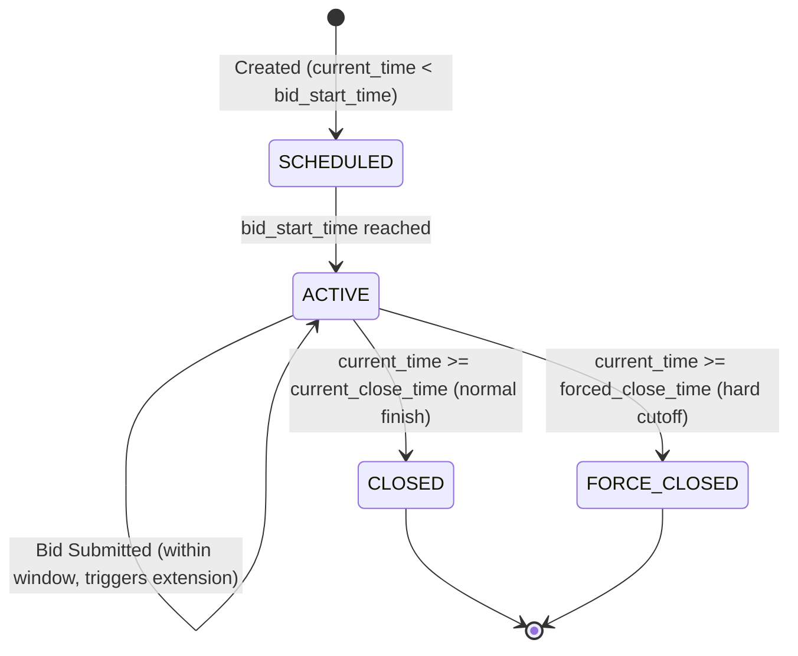

# British Auction Rules & Execution Engine Specification

This document provides the formal operational specification for the British Auction implementation within the RFQ (Request for Quotation) system.

---

## 1. Auction Lifecycle & State Machine

### State Definitions
1. **`SCHEDULED`**: The RFQ is published, but the start time has not arrived. Bids are rejected.
2. **`ACTIVE`**: The auction is open for bidding:
   $$\text{bid\_start\_time} \le t_{\text{now}} < \text{current\_close\_time} \quad \text{AND} \quad t_{\text{now}} < \text{forced\_close\_time}$$
3. **`CLOSED`**: The auction ended normally because no qualifying bids extended the auction during the trigger window, and $t_{\text{now}} \ge \text{current\_close\_time} < \text{forced\_close\_time}$.
4. **`FORCE_CLOSED`**: The auction was terminated because the absolute forced close deadline was reached ($t_{\text{now}} \ge \text{forced\_close\_time}$), regardless of any late bids.

---

## 2. Trigger Window ($X$) and Extension Duration ($Y$)

### Exact Boundary Formula
Let:
- $T_{\text{close}}$ = Current effective bid close time (`current_close_time`).
- $T_{\text{forced}}$ = Forced close deadline (`forced_close_time`).
- $X$ = Trigger window in minutes (`trigger_window_minutes`).
- $Y$ = Extension duration in minutes (`extension_duration_minutes`).
- $t_{\text{sub}}$ = Bid submission time (UTC timestamp).

The bid occurs within the trigger window if and only if:
$$(T_{\text{close}} - X \text{ minutes}) \le t_{\text{sub}} < T_{\text{close}}$$

*Crucial Architecture Point*: The trigger window is evaluated dynamically against $T_{\text{close}}$, which advances as extensions occur, not against the static initial close time.

---

## 3. Extension Trigger Modes

### Mode 1: Bid Received in Last $X$ Minutes (`BID_RECEIVED`)
- **Condition**: Any valid bid submitted by any eligible supplier during the trigger window causes an extension.
- **Trigger**: $\text{in\_trigger\_window} == \text{True}$.

### Mode 2: Any Supplier Rank Change in Last $X$ Minutes (`ANY_RANK_CHANGE`)
- **Condition**: A valid bid is placed that shifts the ranking order of suppliers.
- **Algorithm**:
  1. Determine the vector of suppliers and their ranks $[\text{Supplier}_i \to \text{Rank}_i]$ before the bid.
  2. Compute the vector of suppliers and their ranks after inserting the new bid.
  3. If $\exists \, \text{Supplier}_i$ such that $\text{Rank}_{\text{before}}(i) \ne \text{Rank}_{\text{after}}(i)$, trigger extension.
- **Example**: Supplier B is at L2 ($5,000). At 5:58 PM (window 5:50–6:00), Supplier B submits $4,800, jumping over Supplier A ($4,900) to L1. Both Supplier B and Supplier A have rank changes $\to$ Auction extends by $Y$ minutes.
- **Non-triggering Example**: Supplier C is at L3 ($6,000) and submits $5,900. L1 ($4,800) and L2 ($4,900) remain unchanged, and Supplier C remains L3 $\to$ No rank change $\to$ No extension.

### Mode 3: Lowest Bidder (L1) Rank Change in Last $X$ Minutes (`L1_RANK_CHANGE`)
- **Condition**: An extension occurs **only** when the incumbent L1 (lowest-priced bidder) is dethroned.
- **Algorithm**:
  $$\text{L1}_{\text{before}} \ne \text{L1}_{\text{after}}$$
- **Example**: Carrier A is L1 with $4,000. Carrier C submits $4,200 (overtaking Carrier B at $4,500 for L2). Carrier A is still L1. Mode 3 will **not** extend the auction.
- If Carrier C submits $3,900, becoming the new L1, Mode 3 **triggers an extension**.

---

## 4. Forced Close Capping Rule

Extensions can **never** push the auction past $T_{\text{forced}}$:
$$T_{\text{new\_close}} = \min(T_{\text{close}} + Y \text{ minutes}, T_{\text{forced}})$$

1. If $T_{\text{close}} + Y > T_{\text{forced}}$, the auction is extended only up to $T_{\text{forced}}$.
2. If $T_{\text{close}} == T_{\text{forced}}$, no further extensions are permitted; incoming bids are accepted if $t_{\text{sub}} < T_{\text{forced}}$, but no time is added.

---

## 5. Ranking and Tie-Breaking Policy
- **Ranking Metric**: Total Quote Amount = $\text{freight\_charges} + \text{origin\_charges} + \text{destination\_charges}$.
- **Ascending Order**: Lowest total quote receives Rank 1 (L1), second-lowest Rank 2 (L2), etc.
- **Deterministic Tie-Breaking**: If two quotes have identical totals, the quote with the earlier `submitted_at` timestamp takes priority (First-In, First-Out).
- **Multiple Bids Policy**: A supplier can submit multiple quotes throughout the auction to lower their price. A supplier's active rank is always determined by their best (lowest) quote to date. Bids higher than a supplier's own previous best quote are rejected to preserve the descending-price integrity.
