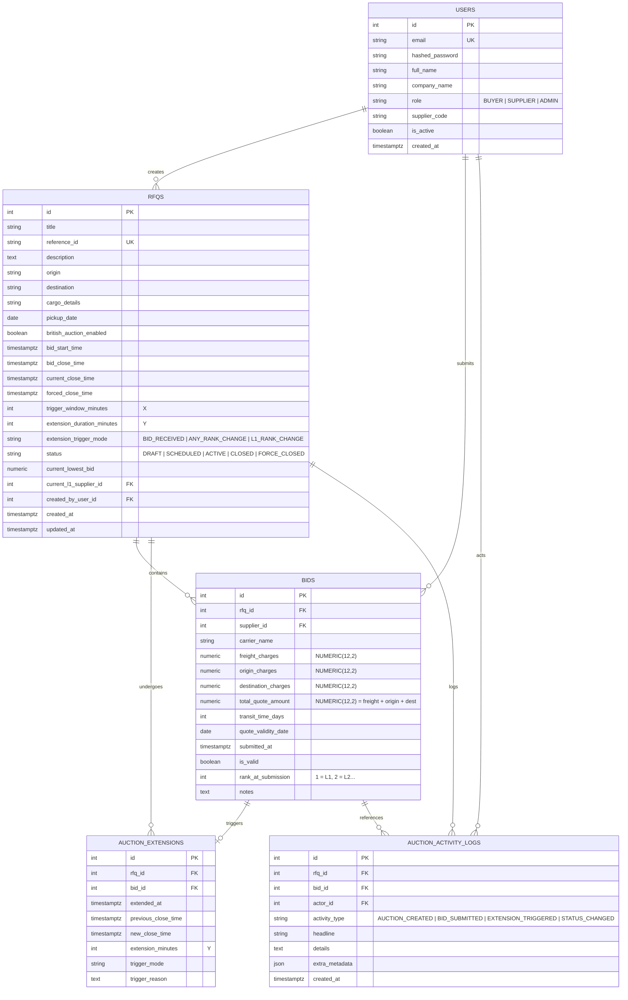

# Database Schema Design — British Auction in RFQ System

This document outlines the entity-relationship model, tables, columns, indexes, constraints, and audit strategy for the British Auction RFQ system.

---

## 1. Entity-Relationship Diagram (Mermaid)

---

## 2. Table Specifications & Precision Guarantees

### 2.1 `users`
Represents buyers, logistics managers, and participating carriers/suppliers.
- `id`: `INTEGER PRIMARY KEY GENERATED BY DEFAULT AS IDENTITY`
- `email`: `VARCHAR(255) UNIQUE NOT NULL` (Index: `ix_users_email`)
- `role`: `VARCHAR(50) NOT NULL` (`BUYER`, `SUPPLIER`, `ADMIN`)
- `supplier_code`: `VARCHAR(50) NULL` (Index: `ix_users_supplier_code`)

### 2.2 `rfqs`
Represents the Request for Quotation and its British Auction parameters.
- `id`: `INTEGER PRIMARY KEY`
- `reference_id`: `VARCHAR(100) UNIQUE NOT NULL` (Index: `ix_rfqs_reference_id`)
- `bid_start_time`: `TIMESTAMPTZ NOT NULL`
- `bid_close_time`: `TIMESTAMPTZ NOT NULL` (Original scheduled close time)
- `current_close_time`: `TIMESTAMPTZ NOT NULL` (Dynamic effective close time, Index: `ix_rfqs_current_close_time`)
- `forced_close_time`: `TIMESTAMPTZ NOT NULL` (Hard absolute cutoff, Index: `ix_rfqs_forced_close_time`)
- `trigger_window_minutes`: `INTEGER NOT NULL` ($X$ minutes)
- `extension_duration_minutes`: `INTEGER NOT NULL` ($Y$ minutes)
- `extension_trigger_mode`: `VARCHAR(50) NOT NULL`
- `status`: `VARCHAR(50) NOT NULL` (Index: `ix_rfqs_status`)

### 2.3 `bids`
Immutable audit log of all quotes submitted by suppliers.
- `id`: `INTEGER PRIMARY KEY`
- `rfq_id`: `INTEGER NOT NULL REFERENCES rfqs(id) ON DELETE CASCADE`
- `supplier_id`: `INTEGER NOT NULL REFERENCES users(id)`
- `freight_charges`: `NUMERIC(12, 2) NOT NULL`
- `origin_charges`: `NUMERIC(12, 2) NOT NULL`
- `destination_charges`: `NUMERIC(12, 2) NOT NULL`
- `total_quote_amount`: `NUMERIC(12, 2) NOT NULL` (Index: `ix_bids_total_quote_amount`)
- `submitted_at`: `TIMESTAMPTZ NOT NULL` (Index: `ix_bids_submitted_at`)

### 2.4 `auction_extensions`
Tracks every time extension event, preserving previous and new close times and the exact trigger rationale.
- `id`: `INTEGER PRIMARY KEY`
- `rfq_id`: `INTEGER NOT NULL REFERENCES rfqs(id) ON DELETE CASCADE`
- `bid_id`: `INTEGER NULL REFERENCES bids(id) ON DELETE SET NULL`
- `extended_at`: `TIMESTAMPTZ NOT NULL`
- `previous_close_time`: `TIMESTAMPTZ NOT NULL`
- `new_close_time`: `TIMESTAMPTZ NOT NULL`
- `extension_minutes`: `INTEGER NOT NULL`
- `trigger_reason`: `TEXT NOT NULL`

### 2.5 `auction_activity_logs`
Chronological activity feed displaying bids, rank updates, extensions, and lifecycle events.
- `id`: `INTEGER PRIMARY KEY`
- `rfq_id`: `INTEGER NOT NULL REFERENCES rfqs(id) ON DELETE CASCADE`
- `activity_type`: `VARCHAR(50) NOT NULL`
- `headline`: `VARCHAR(255) NOT NULL`
- `details`: `TEXT NULL`
- `extra_metadata`: `JSON NULL`
- `created_at`: `TIMESTAMPTZ NOT NULL` (Index: `ix_auction_activity_logs_created_at`)

---

## 3. Auditing & Immutability Strategy
1. **Never Overwrite Bids**: When a supplier submits a lower quote to improve their rank, previous bids remain in the `bids` table with their original timestamps and rank stamps.
2. **Deterministic Current Standing**: A supplier's active standing in the live auction is derived by selecting each supplier's lowest valid bid, ordered ascending by `total_quote_amount`, and tie-broken by `submitted_at ASC`.
