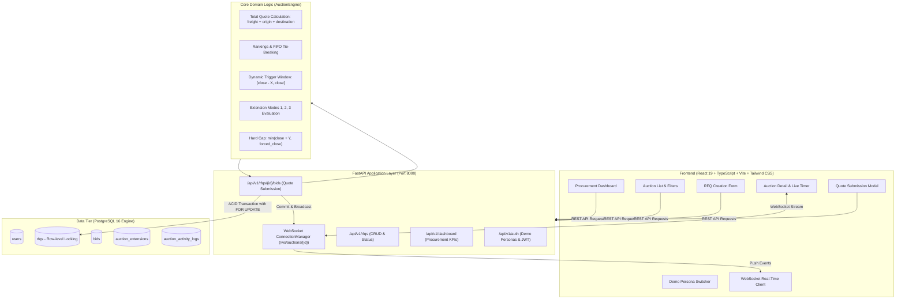
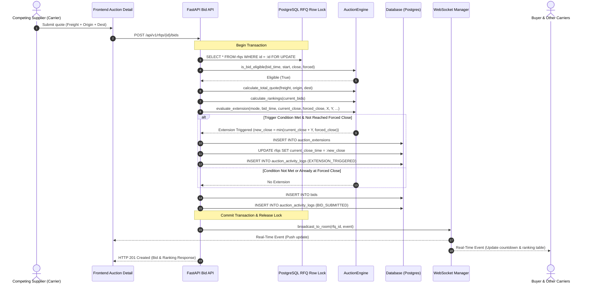

# High-Level Design (HLD): British Auction RFQ System

## 1. Executive Architecture Summary

The British Auction RFQ System is an enterprise-grade reverse procurement platform designed for competitive freight contracting. In contrast to standard forward English auctions (where bids increment), a **British Reverse Auction** operates on descending pricing with dynamic deadline extensions triggered by late bidding activity, strictly constrained by a hard ceiling known as the **Forced Close Deadline**.

---

## 2. Component Breakdown

### 2.1 Frontend Client
- **Tech Stack**: React 19, TypeScript, Vite, Tailwind CSS v4, TanStack Query, React Hook Form, Zod.
- **Key Modules**:
  - `DashboardPage`: Real-time operational overview with KPI metrics, lowest leading bids, upcoming deadlines, and activity logs.
  - `AuctionListPage`: Searchable, filterable table displaying status badges, trigger modes, leading bids, and close times.
  - `CreateRFQPage`: Logistics specification form with British Auction parameters ($X, Y$, Mode 1/2/3, Forced Close cap).
  - `AuctionDetailPage`: Full auction control room showing shipment specs, British Auction mechanics cards, SVG countdown timer, supplier rankings (L1, L2...), quote breakdowns, activity timeline, and extension history.
  - `BidSubmissionModal`: Real-time quote submission interface with automatic sum calculation (`freight + origin + destination`) and descending price validation.
  - `Navbar` & `PersonaSwitcher`: Allows instant persona toggling between the Buyer and competing Suppliers with zero logout overhead.

### 2.2 Backend Service Layer
- **Tech Stack**: FastAPI, Python 3.12, SQLAlchemy 2 (async-ready declarative), Alembic, Pydantic v2.
- **Key Services**:
  - `AuctionEngine`: Decoupled, pure functional domain engine evaluating boundaries, FIFO tie-breaking, dynamic trigger windows, trigger modes 1, 2, 3, and forced-close capping.
  - `BidService`: Transactional service managing database row locks (`with_for_update()`), ensuring race-free concurrency during bid evaluation.
  - `RFQService`: RFQ lifecycle state management, filter queries, detail composition, and procurement KPI aggregation.
  - `ConnectionManager`: WebSocket room manager broadcasting `BID_SUBMITTED`, `AUCTION_EXTENDED`, and `AUCTION_CLOSED` events.

---

## 3. Dynamic British Auction Lifecycle & Extension Sequence

---

## 4. Trigger Mode State Logic

| Mode | Trigger Name | Condition for +Y Extension | Evaluation Window |
| :--- | :--- | :--- | :--- |
| **Mode 1** | **Bid Received** | Any valid bid submitted | $[T_{\text{close}} - X, T_{\text{close}}]$ |
| **Mode 2** | **Any Rank Change** | Any supplier moves up or down in rankings | $[T_{\text{close}} - X, T_{\text{close}}]$ |
| **Mode 3** | **L1 Rank Change** | The leading bidder (Rank 1) is dethroned | $[T_{\text{close}} - X, T_{\text{close}}]$ |

### Forced Close Cap Formula
$$\text{New Close Time} = \min(T_{\text{current\_close}} + Y, T_{\text{forced\_close}})$$
If $T_{\text{current\_close}} \ge T_{\text{forced\_close}}$, no further extension occurs, and the status permanently shifts to `FORCE_CLOSED`.
